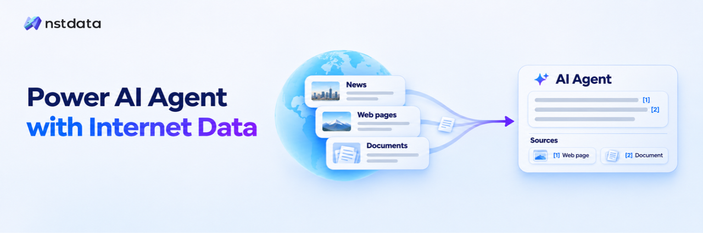
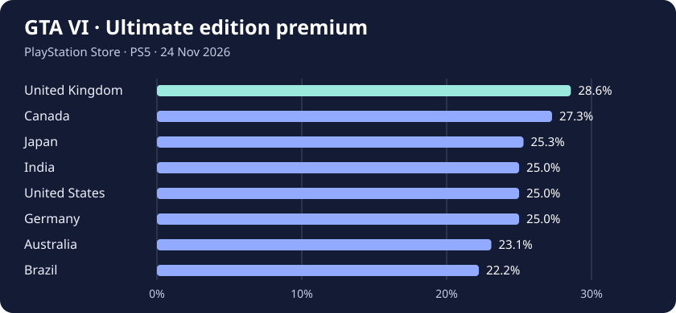

<p align="center">
  
</p>

<h1 align="center">Nstdata Product Scout</h1>

<p align="center">Give your AI assistant product links and get a cross-market price report with a source for every price.</p>

<p align="center">
  <a href="https://github.com/nstdata-ai/nstdata-skills/raw/refs/heads/main/downloads/nstdata-product-scout.zip"></a>
  <a href="https://github.com/nstdata-ai/nstdata-skills/raw/refs/heads/main/downloads/GTA-VI-Price-Watch.zip"></a>
  <a href="../examples/black-friday/Black-Friday-Price-Watch.md"></a>
</p>

<p align="center"><strong>English</strong> · <a href="README_zh.md">简体中文</a></p>

---

## Black Friday example



Upgrading from Standard to Ultimate cost **£20 in the UK** and **¥2,480 in Japan** on November 24, 2026. The chart compares that difference as a percentage of each store’s Standard price. None of the eight markets showed a Black Friday sale label in this snapshot.

Unzip the interactive report and open the HTML file. Choose **Compare two markets** to see both editions side by side, then **View the store evidence** to inspect the listings behind the figures.

## Quick start

### 1. Install Product Scout

[Download Product Scout (ZIP)](https://github.com/nstdata-ai/nstdata-skills/raw/refs/heads/main/downloads/nstdata-product-scout.zip). Unzip it and place the entire `nstdata-product-scout` folder in your client’s skills directory. In a Claude Code project, the instructions should be at `.claude/skills/nstdata-product-scout/SKILL.md`. Open a new conversation. For Cursor, you can instead run this command in a terminal from your project folder:

```sh
npx skills add nstdata-ai/nstdata-skills --skill nstdata-product-scout --agent cursor
```

The Skill returns its findings in English. Generating a new illustrated HTML report requires a client with file tools and Python 3.

### 2. Connect hosted Crawl

Nstdata hosts the MCP server. All you need is a compatible agent, an Nstdata account with available Crawl credits, and browser access to approve the connection. You can skip local Node.js installation. [Open the Nstdata dashboard](https://app.nstdata.io/)

**Paste this into your agent’s chat:**

> Connect this client to the hosted Nstdata Crawl MCP using the official setup instructions at <https://raw.githubusercontent.com/nstdata-ai/nstdata-skills/main/nstdata-mcp-onboarding/SKILL.md>. Reuse an existing connection if available. Show me when the Crawl tools are ready.

If your agent asks you to add the server yourself, open its **MCP settings**, add a server named `nstdata-crawl`, choose **Streamable HTTP**, and paste this server URL:

```text
https://mcp.nstdata.io/crawl
```

Follow the browser authorization prompt. Enter your Nstdata API key on the official Nstdata authorization page when requested, then select **Authorize**. Keep the key out of chat. Back in the client, look for **six Crawl tools**, including `nstdata_crawl_scrape`. If the client saved the connection but the current chat still has no tools, reload the connection or open a new chat. Live checks use your Nstdata credits. [Client-specific setup instructions](https://github.com/nstdata-ai/nstdata-mcp-server/blob/main/docs/remote.md)

### 3. Run a price check

Start with the product pages you already track. Two links are enough for a first run. Copy this example into the connected chat:

> Use Nstdata Crawl to check GTA VI Standard and Ultimate for PS5 on these UK PlayStation Store pages:
> <https://store.playstation.com/en-gb/product/EP1004-PPSA01547_00-GTAVISTANDARD001>
> <https://store.playstation.com/en-gb/product/EP1004-PPSA01547_00-GTAVIULTIMATE001>
>
> Give me both prices in pounds, the extra cost of Ultimate, and any Black Friday offer the store explicitly lists. Show the check time and link each price to its source. If a price is unavailable, mark it unverified.

For your own campaign, replace those links with your competitor’s listings. Add regional URLs for the same model, capacity or bundle to compare markets. Crawl reads URLs you supply. If you only know the product name, an agent with web search can find candidate listings first.

## Read the results and schedule a recheck

Here are three of the eight PlayStation Store markets in our **November 24, 2026** snapshot. Each percentage measures the extra cost of Ultimate against Standard in that same store.

| PS5 market | Standard | Ultimate | Upgrade |
| --- | ---: | ---: | ---: |
| United Kingdom | £69.99 | £89.99 | +£20.00 (+28.6%) |
| Brazil | R$449.90 | R$549.90 | +R$100.00 (+22.2%) |
| Japan | ¥9,800 | ¥12,280 | +¥2,480 (+25.3%) |

In the demo, choose **Compare two markets**, switch Brazil to **Japan**, then open **View the store evidence** to inspect the original listings. None of the eight checked listings showed a Black Friday sale label in that snapshot. The recorded prices give you a baseline for the next check. [Download the interactive report](https://github.com/nstdata-ai/nstdata-skills/raw/refs/heads/main/downloads/GTA-VI-Price-Watch.zip)

If your agent supports scheduled MCP calls and can retain earlier results, try this follow-up:

> Recheck the same listings every day at 9 AM New York time through November 27, 2026. When a price changes, show the previous price, the new price and the store link. Confirm the next scheduled run and its time zone.

## How the Skill verifies prices

For a chat-only workflow, the [standalone English Markdown article](../examples/black-friday/Black-Friday-Price-Watch.md) also includes instructions you can save as a single Skill file. The installable Product Scout package includes the [agent instructions](SKILL.md), HTML templates and Python renderers.

<details>
<summary>Price verification and repeat checks</summary>


1. Use the shopper’s product, variants, markets and store URLs. Treat the GTA VI figures above as a dated example. Start each requested live check from the current store pages. If you lack a URL and a search tool, ask for the listing.
2. Reuse the authorized hosted Nstdata Crawl connection. Submit each distinct page once per check with `nstdata_crawl_scrape` and request Markdown. For a pending task, pass its returned `id` as `taskId` to `nstdata_crawl_scrape_result`. If the body comes back as `markdownRef`, use `nstdata_crawl_read_result` and follow `nextOffset` until you reach the relevant edition and offer text. Resume the existing task if interrupted.
3. Match the exact seller, market and variant. Record the local price and currency, check time with time zone, source URL and a short supporting quote. Label a Black Friday deal only when the store identifies one. Include its end date if shown. Use “Price unverified” when the listing lacks a readable price.
4. Return a short English finding and a source-linked table. For two editions, show both local prices, the difference and the percentage over the base edition when its price is positive. Add a matching product image when available. For HTML requests, return the illustrated comparison when the renderer and file tools are available. Keep amounts in their original currencies.
5. On repeat checks, compare each verified price with its last observation for the same seller, market, edition and currency. Report the old and new amount and timestamp. Schedule future checks only on request, and confirm a next run only after the scheduler accepts it.

</details>
