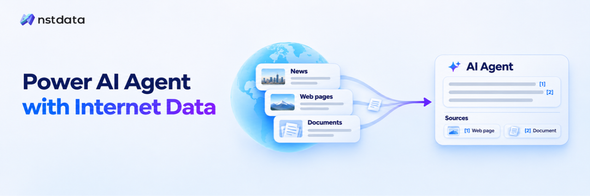
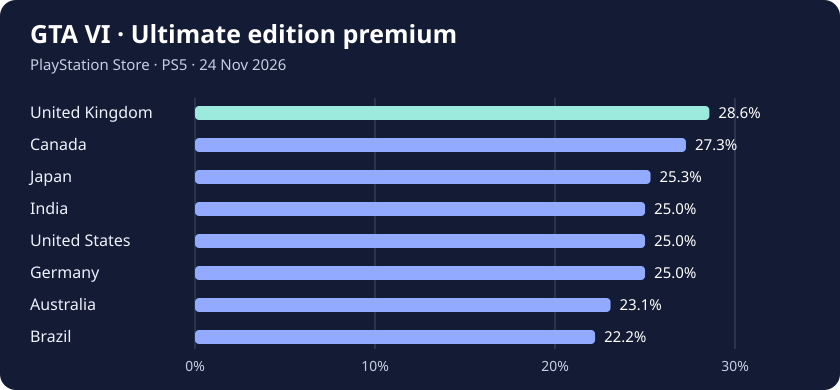

<p align="center">
  
</p>

<h1 align="center">Nstdata Product Scout</h1>

<p align="center">把商品链接发给你的 AI 助手，获取附有来源的跨市场价格对比报告。</p>

<p align="center">
  <a href="https://github.com/nstdata-ai/nstdata-skills/raw/refs/heads/main/downloads/nstdata-product-scout.zip"></a>
  <a href="https://github.com/nstdata-ai/nstdata-skills/raw/refs/heads/main/downloads/GTA-VI-Price-Watch.zip"></a>
  <a href="../examples/black-friday/Black-Friday-Price-Watch.md"></a>
</p>

<p align="center"><a href="README.md">English</a> · <strong>简体中文</strong></p>

---

## 如何用 Nstdata Crawl 监控不同市场的黑五竞品价格



2026 年 11 月 24 日，同样从 GTA VI 标准版升级到终极版，英国商店贵了 **20 英镑**，日本商店贵了 **2,480 日元**。图中按各商店自己的标准版售价计算升级幅度，避免直接比较不同币种的金额。这次抓取的八个市场都没有明确标注黑五折扣。

解压报告，用浏览器打开 HTML，点击 **Compare two markets** 并排查看两个市场的版本与售价，再展开 **View the store evidence** 核对原始商品页。

## 快速开始

### 1. 安装 Product Scout

[下载 Product Scout 安装包（ZIP）](https://github.com/nstdata-ai/nstdata-skills/raw/refs/heads/main/downloads/nstdata-product-scout.zip)。解压后，将整个 `nstdata-product-scout` 文件夹放进客户端的 Skills 目录。以 Claude Code 项目为例，安装后的文件路径应为 `.claude/skills/nstdata-product-scout/SKILL.md`。随后新开一个对话。

如果用 Cursor，也可以在项目目录的终端执行：

```sh
npx skills add nstdata-ai/nstdata-skills --skill nstdata-product-scout --agent cursor
```

你可以用中文提问，Skill 会用英文输出查价结论。要生成新的图文 HTML 报告，客户端还需要能读写文件并运行 Python 3。

### 2. 连接托管 Crawl

准备一个有可用 Crawl 额度的 Nstdata 账号。托管服务由 Nstdata 运行，连接时可以跳过本地 Node.js 安装。[打开 Nstdata 控制台](https://app.nstdata.io/)

把这句话发到 Agent **对话框**：

> 请按照 <https://raw.githubusercontent.com/nstdata-ai/nstdata-skills/main/nstdata-mcp-onboarding/SKILL.md> 的官方说明，为当前客户端接入 Nstdata 托管 Crawl MCP。如果已有可用连接，请直接复用。工具就绪后告诉我。

如果客户端提示手动添加，打开 **MCP 设置 → 添加服务器**，名称填 `nstdata-crawl`，连接类型选 **Streamable HTTP**，服务地址填：

```text
https://mcp.nstdata.io/crawl
```

浏览器打开 Nstdata 授权页后，按提示登录账号，确认 **Billing workspace**（本次查价使用额度的工作区），点击 **Authorize and return**。账号授权无需填写 API Key。已有 Crawl API Key 的用户也可以选择 **Use an existing API Key**，在授权页填写后点击 **Authorize**。

回到客户端后，应能看到包括 `nstdata_crawl_scrape` 在内的 6 个 Crawl 工具。如果当前对话尚未发现工具，重新加载连接或新开对话。[各客户端接入说明](https://github.com/nstdata-ai/nstdata-mcp-server/blob/main/docs/remote_zh.md)

### 3. 在对话中查价

下面的提示词可以直接发到已连接的对话里。第一次只查英国区的两个版本，就能看到从商品页到查价结果的完整过程。

> 请用 Nstdata Crawl 抓取下面两个英国 PlayStation Store 商品页，比较 PS5 版 GTA VI 标准版和终极版。列出两款的英镑售价、升级差价，以及商店明确标出的黑五优惠。附上查价时间和每个价格的来源链接。读不到的价格标为“未核实”。请用英文返回结果。
>
> 标准版：<https://store.playstation.com/en-gb/product/EP1004-PPSA01547_00-GTAVISTANDARD001>
>
> 终极版：<https://store.playstation.com/en-gb/product/EP1004-PPSA01547_00-GTAVIULTIMATE001>

换成你自己关注的商品时，直接替换链接。要做跨市场对比，再加上同一型号、容量或套装在其他国家的商品页。只有商品名时，可先让具备搜索能力的 Agent 找到候选页面，再交给 Crawl 读取。

## 阅读结果并设置复查

下面是 **2026 年 11 月 24 日**八市场快照中的三组结果。升级幅度按各市场自己的标准版价格计算。

| PS5 商店 | 标准版 | 终极版 | 升级差价（幅度） |
| --- | ---: | ---: | ---: |
| 英国 | £69.99 | £89.99 | +£20.00（28.6%） |
| 巴西 | R$449.90 | R$549.90 | +R$100.00（22.2%） |
| 日本 | ¥9,800 | ¥12,280 | +¥2,480（25.3%） |

在示例报告中点 **Compare two markets**，将巴西切换为 **Japan**，就能并排查看英国和日本的升级差价。展开 **View the store evidence** 可以核对各版本的商店原文。这次查看的八个市场都没有明确标注黑五促销，因此这些数字可作为下次查价的基准。[下载交互报告（ZIP）](https://github.com/nstdata-ai/nstdata-skills/raw/refs/heads/main/downloads/GTA-VI-Price-Watch.zip)

如果客户端支持定时调用 MCP 并保存上次结果，可接着在对话里说：

> 从今天起到 2026 年 11 月 27 日，每天纽约时间上午 9 点复查同一批商品。价格有变化时，列出原价、新价和商店链接。任务创建成功后，告诉我下次运行时间和时区。

## Skill 怎样核对价格

<details>
<summary>展开查看价格核验和复查规则</summary>

1. **核对商品。** 按用户指定的商店、市场和版本读取当时的商品页。缺少链接且 Agent 无法搜索时，请用户提供网址。
2. **读取正文。** 每轮对每个不同的商品页提交一次 `nstdata_crawl_scrape`。任务尚在处理时，将返回的 `id` 作为 `taskId` 传给 `nstdata_crawl_scrape_result`。收到 `markdownRef` 后，用 `nstdata_crawl_read_result` 读取，并按 `nextOffset` 接着读到相关价格。中断后接续已有任务。
3. **留存依据。** 记录商家、商品版本、当地币种、查价时间与时区、来源链接和支持该价格的原文。只有商店明确给出黑五优惠时才标注促销，同时保留页面写明的截止时间。
4. **展示结果。** 用英文摘要和表格列出两款当地售价、差价和升级幅度，有匹配的商品图时一并展示。缺失的价格标为未核实。需要 HTML 时，用包内模板和 Python 脚本生成报告。
5. **跟踪变化。** 复查时，只比较同一商店、市场、版本和币种的两次记录。首次查价建立基准。用户要求定时监控时，待调度器确认后再报告下次运行时间。

</details>

如果只想在对话里查一次，可以直接用上面的提示词。需要单文件安装时，英文宣发稿中也附有可独立使用的指令；完整安装包还包含交互报告所需的模板和渲染脚本。[英文宣发原稿](../examples/black-friday/Black-Friday-Price-Watch.md) · [英文 Skill 指令](SKILL.md)
